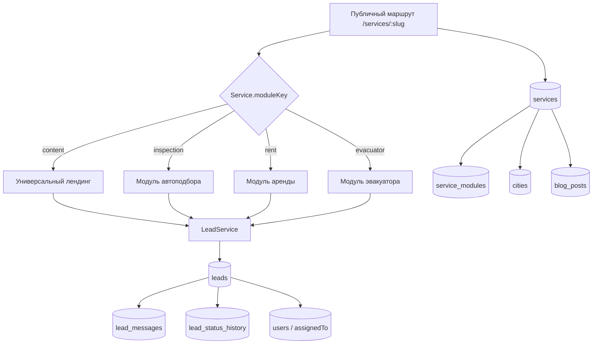

# АВТОWAY: масштабируемые услуги, CRM и SEO

Дата: 28.10.2026  
Статус: архитектурное предложение + отчёт о быстрых победах, уже внесённых в код.  
Ограничения: Next.js 16.2.10, React 19, Tailwind 4, Prisma 7, SQLite в dev / PostgreSQL в prod. Существующие данные не удаляем, `prisma migrate reset` не используем.

---

## 1. Кратко

Сейчас сайт хорошо работает как набор отдельных модулей:

- аренда — `/services/rent`, `/admin/rent`, свои таблицы;
- автоподбор — `/services/inspection`, `/admin/inspection`, 13 таблиц;
- остальные услуги — generic-страница `/services/[slug]` с `title`, `description`, `content`, `photo`;
- заявки лежат в трёх независимых таблицах: `contact_requests`, `rent_requests`, `autopodbor_leads`.

Для следующей услуги («Эвакуатор», «Пригон», «Детейлинг», «Таксопарк») нельзя снова копировать целый лендинг, админку и таблицу заявок. Нужны три общие абстракции:

1. **ServiceModule** — какой шаблон лендинга и какая админка используются для услуги.
2. **Lead** — единая заявка из любого источника, с историей сообщений и статусов.
3. **SEO-контракт** — у каждой услуги и города есть свои title/description/canonical/OG/JSON-LD/sitemap.

Предлагается не «переписать всё», а постепенно:

- оставить `rent` и `inspection` как есть;
- добавить реестр модулей и поле `Service.moduleKey`;
- новые услуги делать через конфигурацию и generic-шаблон;
- заявки мигрировать в `leads` через обратимую схему dual-write;
- старые таблицы оставить read-only до полной проверки.

---

## 2. Целевая схема



### 2.1. Поток создания заявки

```text
Форма / квиз / звонок / Telegram / Instagram / Viber / WhatsApp
        ↓
POST /api/leads (единый контракт)
        ↓
LeadService.create({ source, serviceSlug, channel, ... })
        ↓
leads + lead_status_history(new)
        ↓
Уведомление ответственному (email / Telegram)
        ↓
Админка /admin/leads — единая лента, фильтры по услуге/источнику/статусу
```

Важно: публичные формы не должны знать, в какую таблицу писать. Они отправляют `serviceSlug` и `source`, а инфраструктурный слой решает, куда сохранить.

---

## 3. ServiceModule: как добавить услугу без копипасты

### 3.1. Минимальная абстракция

```ts
// src/entities/service-module/service-module.types.ts
export type ServiceTemplate = "content" | "rent" | "inspection" | "evacuator";

export interface ServiceModuleDefinition {
  key: string;
  template: ServiceTemplate;
  title: string;
  /** Можно ли включать/выключать в админке */
  isConfigurable: boolean;
  /** Публичный компонент; для generic-шаблона не задаётся */
  publicComponent?: () => Promise<{ default: React.ComponentType<ServicePageProps> }>;
  /** Админ-вкладка; для generic-шаблона не задаётся */
  adminComponent?: () => Promise<{ default: React.ComponentType }>;
  /** Какие поля landingConfig поддерживает модуль */
  configSchema?: unknown;
}

export interface ServicePageProps {
  service: Service;
  config: Record<string, unknown>;
}
```

```ts
// src/features/service-modules/registry.ts
import type { ServiceModuleDefinition } from "@/entities/service-module/service-module.types";

export const SERVICE_MODULES: Record<string, ServiceModuleDefinition> = {
  content: {
    key: "content",
    template: "content",
    title: "Универсальная страница",
    isConfigurable: true,
  },
  rent: {
    key: "rent",
    template: "rent",
    title: "Аренда",
    isConfigurable: false,
    publicComponent: () => import("@/features/rent/ui/rent-page"),
    adminComponent: () => import("@/features/admin/rent/ui/rent-admin"),
  },
  inspection: {
    key: "inspection",
    template: "inspection",
    title: "Автоподбор",
    isConfigurable: false,
    publicComponent: () => import("@/features/autopodbor/ui/autopodbor-page"),
    adminComponent: () => import("@/features/admin/autopodbor/ui/autopodbor-admin"),
  },
};
```

Публичный маршрут остаётся один:

```tsx
// src/app/(marketing)/services/[slug]/page.tsx
const service = await serviceRepo.getBySlug(slug);
if (!service?.isActive) notFound();

const module = SERVICE_MODULES[service.moduleKey] ?? SERVICE_MODULES.content;
const Component = module.publicComponent
  ? (await module.publicComponent()).default
  : ContentServicePage;

return <Component service={service} config={parseConfig(service.landingConfig)} />;
```

`rent` и `inspection` могут ещё какое-то время жить отдельными route-сегментами. Тогда реестр используется только для **новых** услуг, а `services/[slug]` проверяет: если для slug есть выделенный route, он имеет приоритет. Это позволяет не ломать существующие страницы.

### 3.2. Изменения в `Service`

Добавить в `prisma/schema.prisma`:

```prisma
model Service {
  id              String   @id @default(uuid())
  slug            String   @unique
  title           String
  description     String?
  content         String?
  photo           String?
  icon            String   @default("car")
  color           String   @default("#E74C3C")
  isActive        Boolean  @default(true) @map("is_active")
  sortOrder       Int      @default(0) @map("sort_order")

  // Новые поля
  moduleKey       String   @default("content") @map("module_key")
  parentId        String?  @map("parent_id")
  parent          Service? @relation("ServiceTree", fields: [parentId], references: [id], onDelete: SetNull)
  children        Service[] @relation("ServiceTree")

  seoTitle        String?  @map("seo_title")
  seoDescription  String?  @map("seo_description")
  ogImage         String?  @map("og_image")
  noindex         Boolean  @default(false)
  landingConfig   String?  @map("landing_config") // JSON-строка; SQLite-safe

  createdAt       DateTime @default(now()) @map("created_at")
  updatedAt       DateTime @updatedAt @map("updated_at")

  @@index([moduleKey, isActive])
  @@map("services")
}
```

Почему `landingConfig` строкой: SQLite и PostgreSQL одинаково переносят `String`, а JSON-поле в Prisma/SQLite добавляет лишние ограничения. Валидацию делаем Zod-схемой модуля.

### 3.3. Пример: услуга «Эвакуатор»

1. Добавить модуль в реестр:

```ts
evacuator: {
  key: "evacuator",
  template: "evacuator",
  title: "Эвакуатор",
  isConfigurable: true,
  publicComponent: () => import("@/features/service-modules/evacuator/ui/evacuator-page"),
  adminComponent: () => import("@/features/service-modules/evacuator/ui/evacuator-admin"),
},
```

2. Создать фичу:

```text
src/features/service-modules/evacuator/
  ui/evacuator-page.tsx
  ui/evacuator-admin.tsx
  model/evacuator.config.ts
  lib/evacuator-price.ts
```

3. Завести услугу в БД (без правки кода страницы):

```ts
await db.service.create({
  data: {
    slug: "evacuator",
    title: "Эвакуатор в Минске",
    description: "Перевозка авто по Минску и Беларуси, работаем 24/7.",
    moduleKey: "evacuator",
    seoTitle: "Эвакуатор в Минске — выезд 24/7 | АВТОWAY",
    seoDescription: "Эвакуатор по Минску и области. Цена от 80 BYN, подача от 20 минут.",
    isActive: true,
    landingConfig: JSON.stringify({
      priceFrom: 80,
      phone: "+375...",
      cities: ["minsk", "borisov", "molodechno"],
    }),
  },
});
```

4. Форма эвакуатора отправляет:

```ts
await fetch("/api/leads", {
  method: "POST",
  body: JSON.stringify({
    name, phone,
    serviceSlug: "evacuator",
    source: "site",
    channel: "form",
    message: "Нужен эвакуатор с ул. ... на ...",
  }),
});
```

5. SEO появляется автоматически: `/services/evacuator` попадает в sitemap из БД, получает breadcrumbs, canonical, JSON-LD и `Service`-метаданные.

---

## 4. Единая CRM

### 4.1. Схема

```prisma
model Lead {
  id            String   @id @default(uuid())
  name          String
  phone         String?
  email         String?
  messenger     String?  // telegram | instagram | viber | whatsapp
  message       String?

  source        String   @default("site") // site | phone | telegram | instagram | viber | whatsapp | email
  channel       String   @default("form") // form | quiz | call | chat | email
  serviceSlug   String?  @map("service_slug")
  pageUrl       String?  @map("page_url")

  status        String   @default("new")  // new | in_progress | qualified | won | lost
  assignedToId  String?  @map("assigned_to_id")
  assignedTo    User?    @relation("LeadAssignee", fields: [assignedToId], references: [id], onDelete: SetNull)

  utmSource     String?  @map("utm_source")
  utmMedium     String?  @map("utm_medium")
  utmCampaign   String?  @map("utm_campaign")
  utmContent    String?  @map("utm_content")
  utmTerm       String?  @map("utm_term")

  // Для обратимой миграции старых заявок
  legacyTable   String?  @map("legacy_table")
  legacyId      String?  @map("legacy_id")

  createdAt     DateTime @default(now()) @map("created_at")
  updatedAt     DateTime @updatedAt @map("updated_at")

  messages      LeadMessage[]
  statusHistory LeadStatusHistory[]
  transactions  Transaction[]

  @@unique([legacyTable, legacyId])
  @@index([serviceSlug, createdAt])
  @@index([status, createdAt])
  @@index([assignedToId, status])
  @@map("leads")
}

model LeadMessage {
  id          String   @id @default(uuid())
  leadId      String   @map("lead_id")
  lead        Lead     @relation(fields: [leadId], references: [id], onDelete: Cascade)
  direction   String   // incoming | outgoing | internal
  channel     String   // site | telegram | instagram | viber | whatsapp | email | phone
  body        String
  externalId  String?  @map("external_id")
  authorId    String?  @map("author_id") // User.id для исходящих из админки
  createdAt   DateTime @default(now()) @map("created_at")

  @@index([leadId, createdAt])
  @@map("lead_messages")
}

model LeadStatusHistory {
  id         String   @id @default(uuid())
  leadId     String   @map("lead_id")
  lead       Lead     @relation(fields: [leadId], references: [id], onDelete: Cascade)
  fromStatus String?  @map("from_status")
  toStatus   String   @map("to_status")
  comment    String?
  authorId   String?  @map("author_id")
  createdAt  DateTime @default(now()) @map("created_at")

  @@index([leadId, createdAt])
  @@map("lead_status_history")
}
```

Использовать `Int` для сумм, как уже принято в проекте. Если понадобятся копейки — хранить в минорных единицах и документировать.

### 4.2. Миграция без потери данных

**Правило: сначала добавляем новое, потом переключаем чтение, только потом трогаем старое.**

1. **Бэкап.** Для dev: остановить приложение, скопировать `data/avtoway.db` в `data/backups/avtoway-YYYY-MM-DD.db`. Для prod: snapshot PostgreSQL.
2. **Миграция схемы.** Добавить `leads`, `lead_messages`, `lead_status_history` и nullable-поля в `Service` (`moduleKey` с default `"content"`). Старые таблицы не трогать.
3. **Бэкфилл.** Скрипт `scripts/migrate-legacy-leads.ts`:
   - `contact_requests` → `Lead` с `source="site"`, `channel="form"`, `legacyTable="contact_requests"`, `legacyId=id`;
   - `rent_requests` → `Lead` с `serviceSlug="rent"`, `channel="calculator"`, `message` собирается из дат/авто/опций;
   - `autopodbor_leads` → `Lead` с `serviceSlug=lead.serviceSlug ?? "inspection"`, переносит UTM, `assignedToId`, `comment`, `quiz`;
   - `@@unique([legacyTable, legacyId])` защищает от дублей при повторном запуске.
4. **Dual-write.** В `POST /api/contact-requests`, `/api/rent/requests`, `/api/autopodbor/leads` после записи в старую таблицу писать в `Lead` (feature flag `CRM_DUAL_WRITE=true`). Если запись в `Lead` упала — старая заявка уже сохранена, логируем и не теряем лид.
5. **Сверка.** SQL-отчёт: количество по каждой старой таблице = количество `Lead` с соответствующим `legacyTable`; выборочная сверка 10 записей.
6. **Переключение админки.** `/admin/leads` читает `Lead`. Старые разделы (`/admin/requests`, заявки аренды, автоподбора) остаются как read-only или ведут на новую карточку.
7. **Отключение dual-write.** Когда новая лента стабильна, старые таблицы остаются архивом. Удалять их можно только отдельной миграцией после подтверждения владельцем.

Скрипт должен быть идемпотентным: `upsert` по `legacyTable + legacyId`, а не `create`.

### 4.3. API и админка

- `POST /api/leads` — публичный, rate limit, honeypot, Zod, `serviceSlug` whitelist.
- `GET /api/leads?status=&service=&source=&q=` — только `requireAuth`, пагинация.
- `PATCH /api/leads/:id` — статус, ответственный, внутренняя заметка.
- `POST /api/leads/:id/messages` — сообщение; для внешних каналов создаёт исходящее через адаптер.
- `/admin/leads` — единая лента, фильтры, карточка с таймлайном; `/admin/leads/[id]`.
- Права: `leads.view`, `leads.manage`, `leads.assign`; не выдавать всем.

---

## 5. SEO-стратегия

### 5.1. Что уже сделано в этом проходе

- `Reveal` больше не скрывает контент: без JS и для краулеров блоки видимы; анимация — только сдвиг.
- Публичные `` переведены на `next/image` (услуги, аренда, калькулятор, галерея).
- `sitemap.ts` стал динамическим: услуги из БД + все активные авто + статические страницы.
- Добавлены breadcrumbs UI + `BreadcrumbList` JSON-LD на публичных страницах.
- Добавлены canonical/OG для `/services`, `/services/rent`, калькулятора, карточек услуг и авто.
- Добавлен `loading="eager"` для аватара в hero и на `/about`.
- Видео-секция не рендерит пустой блок, если YouTube API не настроен.
- Усилен контраст секции «О проекте» на главной.
- `lang="ru"`, `data-scroll-behavior="smooth"`, `SITE_URL` как единый источник адреса.

### 5.2. Структура URL

```text
/                                   главная
/services                           каталог услуг
/services/{serviceSlug}             лендинг услуги
/services/{serviceSlug}/{citySlug}  городской лендинг (следующий этап)
/services/rent/{carSlug}            карточка авто
/services/rent/calculator           калькулятор
/blog                               статьи
/blog/{category}/{postSlug}         статья
```

Правила:

- один canonical на страницу;
- городские страницы не дублируют текст, а добавляют локальные условия, цены, примеры и контакты;
- если городская страница тонкая — `noindex, follow`;
- `privacy` индексируется и имеет canonical `/privacy`; страница есть в sitemap.

### 5.3. SEO-чеклист для каждой новой услуги

- [ ] Уникальный `seoTitle` (≤ 60–65 символов) и `seoDescription` (≤ 155–160).
- [ ] H1 один, совпадает с интентом запроса.
- [ ] Canonical на абсолютный URL.
- [ ] OG/Twitter image 1200×630, локальный файл.
- [ ] Breadcrumbs UI + `BreadcrumbList`.
- [ ] `Service` JSON-LD; для FAQ — `FAQPage`; для цен — `Offer`.
- [ ] Страница есть в динамическом sitemap.
- [ ] Внутренние ссылки: главная → услуга, услуга → калькулятор/форма, услуга → другие услуги.
- [ ] Все изображения с `alt`, `width/height` или `fill`, LCP-картинка eager.
- [ ] Нет `noindex` у страницы, которая в sitemap.
- [ ] Мобильная проверка 390×844, тарифы/карточки не ломаются.
- [ ] 404/redirect для старых URL.
- [ ] Проверка в Rich Results Test и Search Console.

### 5.4. Локальное SEO

- Таблица `City`: `slug`, `name`, `region`, `isActive`, `seoTitle`, `seoDescription`, `content`, `sortOrder`.
- Шаблон `/services/{serviceSlug}/{citySlug}` с уникальным H1, локальными ценами и примерами.
- Не создавать 100 одинаковых страниц. Сначала 5–7 городов, где реально работаете.
- Для каждой city-страницы — свой canonical, sitemap, breadcrumbs, `LocalBusiness`/`Service` с `areaServed`.

### 5.5. Блог

```prisma
model BlogCategory {
  id    String @id @default(uuid())
  slug  String @unique
  name  String
  posts BlogPost[]
  @@map("blog_categories")
}

model BlogPost {
  id          String   @id @default(uuid())
  slug        String   @unique
  title       String
  excerpt     String?
  content     String
  cover       String?
  categoryId  String?  @map("category_id")
  category    BlogCategory? @relation(fields: [categoryId], references: [id], onDelete: SetNull)
  seoTitle    String?  @map("seo_title")
  seoDescription String? @map("seo_description")
  publishedAt DateTime? @map("published_at")
  isPublished Boolean  @default(false) @map("is_published")
  createdAt   DateTime @default(now()) @map("created_at")
  updatedAt   DateTime @updatedAt @map("updated_at")
  @@index([isPublished, publishedAt])
  @@map("blog_posts")
}
```

Приоритетные темы: «как проверить авто перед покупкой», «аренда авто в Минске: документы и залог», «что проверить в подержанном авто», «эвакуатор: когда нужен и сколько стоит».

### 5.6. Техническое SEO

- **CSP:** сделать report-only, затем nonce-based. Next 16 inline bootstrap требует nonce; начинать с `Content-Security-Policy-Report-Only`, собрать нарушения, потом включить. Не включать `script-src 'unsafe-inline'` навсегда.
- **hreflang:** сайт русскоязычный; сейчас достаточно `lang="ru"` и `alternates.languages: { ru: "/" }`. Если появится белорусская версия — добавить `be` и отдельные URL, не переводить через JS.
- **Core Web Vitals:** LCP — hero-картинка/заголовок; не грузить все фото авто сразу; `next/image` + `sizes`; видео `preload="metadata"`, постер.
- **Sitemap:** генерировать из БД, `revalidate=3600`, не включать `noindex` и админку.
- **Robots:** закрыть `/admin/`, `/api/`, `/_next/`; sitemap указать.

---

## 6. Интеграции

### 6.1. Единая таблица

```prisma
model Integration {
  id          String   @id @default(uuid())
  key         String   @unique // telegram, instagram, viber, whatsapp, smtp, imap, avby
  provider    String
  config      String   // AES-256-GCM encrypted JSON
  isActive    Boolean  @default(false) @map("is_active")
  createdAt   DateTime @default(now()) @map("created_at")
  updatedAt   DateTime @updatedAt @map("updated_at")
  @@map("integrations")
}
```

Токены не хранить в открытом виде. Использовать существующий `ENCRYPTION_KEY` и модуль шифрования; в админке показывать только маску.

### 6.2. Адаптеры

```ts
interface LeadChannelAdapter {
  key: "telegram" | "instagram" | "viber" | "whatsapp" | "email";
  send(message: OutgoingMessage): Promise<{ externalId: string }>;
  parseWebhook(payload: unknown): Promise<IncomingMessage>;
}
```

- `POST /api/webhooks/telegram` — secret token в заголовке/URL, идемпотентность по `update_id`.
- Instagram/Viber/WhatsApp — по одному route на провайдера, общий `LeadChannelAdapter`.
- Все входящие создают/находят `Lead` по `phone`/`externalId` и пишут `LeadMessage`.
- Почта: SMTP/IMAP уже есть; обернуть в `EmailAdapter`, не вызывать nodemailer из UI.

### 6.3. av.by

- `AvByClient` в `infrastructure/integrations/avby/`, только server-side.
- Кешировать справочники (марки/модели), не дергать на каждый рендер.
- Импорт объявлений — отдельная команда/крон, не в request path.

### 6.4. Финансы

```prisma
model Transaction {
  id          String   @id @default(uuid())
  type        String   // income | expense
  category    String   // rent | inspection | parts | fuel | tax | salary | other
  amount      Int
  currency    String   @default("BYN")
  leadId      String?  @map("lead_id")
  serviceSlug String?  @map("service_slug")
  carId       String?  @map("car_id")
  description String?
  occurredAt  DateTime @map("occurred_at")
  createdAt   DateTime @default(now()) @map("created_at")
  lead        Lead?    @relation(fields: [leadId], references: [id], onDelete: SetNull)
  car         RentCar? @relation(fields: [carId], references: [id], onDelete: SetNull)
  @@index([type, occurredAt])
  @@index([serviceSlug, occurredAt])
  @@map("transactions")
}
```

Связь с `RentCarHistory` сохранить: история ремонта — расход по авто; `Transaction` — финансовый слой. Не дублировать сумму в двух местах без правила синхронизации.

---

## 7. План внедрения

### Этап 0 — быстрые победы (сделано)

- Reveal не скрывает контент.
- next/image на публичных страницах.
- eager-загрузка аватара.
- динамический sitemap.
- breadcrumbs + JSON-LD.
- canonical/OG для услуг и аренды.
- fallback видео.
- контраст главной.

### Этап 1 — фундамент услуг (1–2 недели)

1. Добавить `Service.moduleKey`, `parentId`, SEO-поля, `landingConfig`.
2. Добавить `ServiceModule`/реестр модулей.
3. Перевести `services/[slug]` на реестр; `rent`/`inspection` оставить отдельными route.
4. Добавить админ-вкладку «Модуль» и валидацию `landingConfig`.
5. Создать первую новую услугу «Эвакуатор» как пилот.
6. SEO-чеклист и sitemap для неё.

### Этап 2 — CRM (2–4 недели)

1. Схема `Lead`, `LeadMessage`, `LeadStatusHistory`.
2. Бэкфилл старых заявок + сверка.
3. Dual-write и feature flag.
4. `/admin/leads` и API.
5. Переключение чтения, старые таблицы read-only.
6. Уведомления ответственному.

### Этап 3 — SEO-контент и города (параллельно)

1. `City` + 5–7 городских страниц для аренды/автоподбора.
2. Блог и 10 статей.
3. Динамический sitemap для города/блога.
4. Search Console, Rich Results Test, проверка Core Web Vitals.

### Этап 4 — интеграции и финансы

1. `Integration` + шифрование.
2. Telegram webhook, затем остальные каналы.
3. av.by client.
4. `Transaction` и отчёты.

### Риски и откат

| Риск | Мера |
|---|---|
| Потеря заявок при миграции | бэкап, upsert, сверка, dual-write |
| Дубли лидов | `legacyTable+legacyId`, нормализация телефона |
| Падение старой админки | feature flag, старые таблицы не удалять |
| Тонкие city-страницы | порог контента, `noindex` |
| CSP ломает Next | сначала report-only, nonce, тест на staging |
| Рост стоимости БД | индексы по `status, createdAt`, `serviceSlug` |

---

## 8. Что не делать сейчас

- Не переписывать `rent` и `inspection` на новую абстракцию «в один коммит».
- Не удалять `contact_requests`, `rent_requests`, `autopodbor_leads` до сверки.
- Не делать 50 городских страниц с одинаковым текстом.
- Не включать строгий CSP без nonce и staging-проверки.
- Не добавлять тяжёлые зависимости ради CRM; текущего стека достаточно.

---

## 9. Решения, которые нужны от владельца

1. Какие 3–5 услуг запускаем следующими и в каком порядке?
2. Какие города реально обслуживаем для локального SEO?
3. Кто ответственный за лиды и какие статусы воронки нужны?
4. Оставляем ли `privacy` индексируемой? Сейчас — да, canonical `/privacy` и страница в sitemap.
5. Нужен ли блог сразу или после CRM?
6. Подтвердить переход на PostgreSQL в prod и стратегию бэкапов.

---

## 10. Итог

Архитектура не требует переписывания сайта. Достаточно:

- добавить `ServiceModule` и SEO-поля в `Service`;
- ввести единый `Lead` с обратимой миграцией;
- вынести города/блог в БД;
- закрепить SEO-контракт для каждой страницы.

Это даёт новый лендинг за часы, а не за копирование 13 таблиц, и единую ленту заявок без потери текущих данных.
